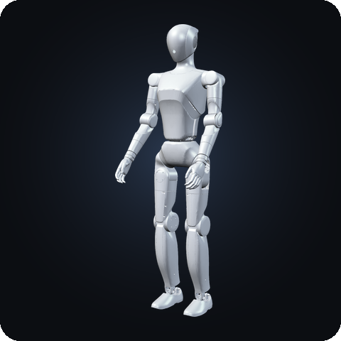
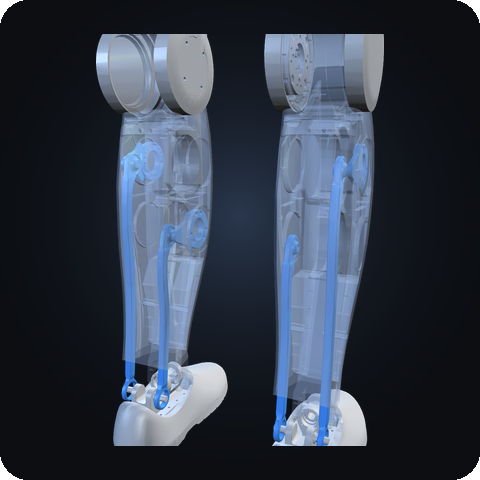

<div align="center">


**English** | [中文](README_cn.md)

[](LICENSE)
[](#ros-1--2)
[](#mujoco)
[](#isaac-sim--isaac-lab)

</div>

# luna-description

URDF, MuJoCo MJCF & USD models for the LimX Dynamics Luna humanoid robot (HU_L04). Provides simulation-ready robot descriptions for ROS, MuJoCo, and NVIDIA Isaac Sim / Isaac Lab.

## Highlights

- **Full-body humanoid, 27 actuated joints.** Legs, a 3-DoF waist, a 2-DoF head and 5-DoF arms, with `rotor_mass` and `gear_ratio` per joint in the SRDF.
- **Parallel linkages modeled faithfully.** The ankles and waist are driven through parallel linkages; the MJCF expresses them with `equality` constraints and `usd_parallel/` as true closed loops.
- **One robot, every simulator.** URDF for ROS, MJCF for MuJoCo, USD for Isaac Sim / Isaac Lab, all from the same geometry.
- **Ready for learning pipelines.** The MJCF ships actuators plus joint position/velocity and IMU sensors, and a kinematics-only variant for motion retargeting.

## Try it in 30 seconds

No ROS needed:

```bash
git clone https://github.com/limxdynamics/luna-description.git
cd luna-description
pip install mujoco
python -m mujoco.viewer --mjcf=HU_L04_description/xml/HU_L04_01.xml
```

## Available models

<table>
  <tr>
    <td align="center" width="50%"></td>
    <td align="center" width="50%"></td>
  </tr>
  <tr>
    <td align="center"><b>HU_L04</b></td>
    <td align="center"><b>HU_L04 (parallel)</b><br><sub>Ankle linkages in blue, rendered from the MJCF with a translucent shank shell</sub></td>
  </tr>
</table>

| Model | Description | URDF | MuJoCo MJCF | USD |
| ----- | ----------- | ---- | ----------- | --- |
| **HU_L04** | Luna humanoid, 27 actuated joints | `urdf/HU_L04_01.urdf` | `xml/HU_L04_01.xml` | `usd/HU_L04_01.usd` |
| **HU_L04 (parallel)** | Same robot with the ankle and waist parallel linkages modeled as closed loops | — | — | `usd_parallel/HU_L04_01.usd` |

> **Note:** Luna's ankles and waist are driven through parallel linkages. URDF cannot represent closed kinematic loops, so the URDF and the matching `usd/` model use a serial approximation in which the ankle and waist joints are driven directly. The MJCF models the linkages with `equality` constraints, and `usd_parallel/` models them as true closed loops for Isaac Lab.

### Joint layout

| Group | DoF | Joints |
| ----- | :-: | ------ |
| Legs  | 6 × 2 | `hip_pitch`, `hip_roll`, `hip_yaw`, `knee`, `ankle_pitch`, `ankle_roll` |
| Waist | 3 | `waist_yaw`, `waist_roll`, `waist_pitch` |
| Head  | 2 | `head_yaw`, `head_pitch` |
| Arms  | 5 × 2 | `shoulder_pitch`, `shoulder_roll`, `shoulder_yaw`, `elbow`, `wrist_yaw` |
| **Total** | **27** | |

Leg and arm joints are prefixed `left_` / `right_`, e.g. `left_knee_joint`.

### MJCF contents

| File | Actuators | Sensors | Parallel linkages |
| ---- | :-------: | ------- | ----------------- |
| `HU_L04_01.xml` | 27 | Joint position and velocity for all 27 joints, base IMU (orientation, gyro, accelerometer) | 6 `<connect>` constraints in `<equality>`: two per ankle, two for the waist |
| `HU_L04_01_vis.xml` | — | — | — (kinematics only, for motion retargeting) |

## Directory structure

`HU_L04_description/` contains:

| Directory        | Contents                                                                                      |
| ---------------- | --------------------------------------------------------------------------------------------- |
| `urdf/`          | URDF + SRDF (per-joint `rotor_mass` and `gear_ratio`)                                          |
| `xml/`           | MuJoCo MJCF: `HU_L04_01.xml` (full dynamics) and `HU_L04_01_vis.xml` (kinematics only)          |
| `usd/`           | NVIDIA USD files, serial approximation consistent with the URDF, + `configuration/` subdirectory |
| `usd_parallel/`  | NVIDIA USD files with the parallel linkages modeled as closed loops, + `configuration/` subdirectory |
| `meshes/`        | STL mesh files                                                                                |
| `world/`         | Gazebo world file (`empty_world.world`)                                                       |
| `CMakeLists.txt` | ROS package build file                                                                        |
| `package.xml`    | ROS package manifest                                                                          |

## Usage

### ROS 1 / 2

The description builds as the ROS package **`HU_L04_description`** on both ROS 1 (catkin) and ROS 2 (ament).

```bash
cd <workspace>/src
git clone https://github.com/limxdynamics/luna-description.git
cd ..
catkin_make  # or colcon build
```

The URDF references meshes as `package://HU_L04_description/meshes/...`. Outside ROS, point your loader's package path at the repository root, or use the MJCF / USD files directly.

### MuJoCo

```bash
python -m mujoco.viewer --mjcf=HU_L04_description/xml/HU_L04_01.xml
```

For motion retargeting, load `HU_L04_01_vis.xml` instead.

### Isaac Sim / Isaac Lab

Import the USD file from `HU_L04_description/usd/HU_L04_01.usd` via Isaac Sim's reference assembly. Use `HU_L04_description/usd_parallel/HU_L04_01.usd` instead if you need the closed-loop parallel linkages.

Both `.usd` files are thin wrappers that reference the assets in the `configuration/` folder next to them, so copy the whole directory rather than the `.usd` file alone.

## Related repositories

[`luna-beyondmimic`](https://github.com/limxdynamics/luna-beyondmimic) — BeyondMimic motion tracking training for Luna (Isaac Lab).

## License

Apache License 2.0 — see [LICENSE](LICENSE) and [NOTICE](NOTICE).
