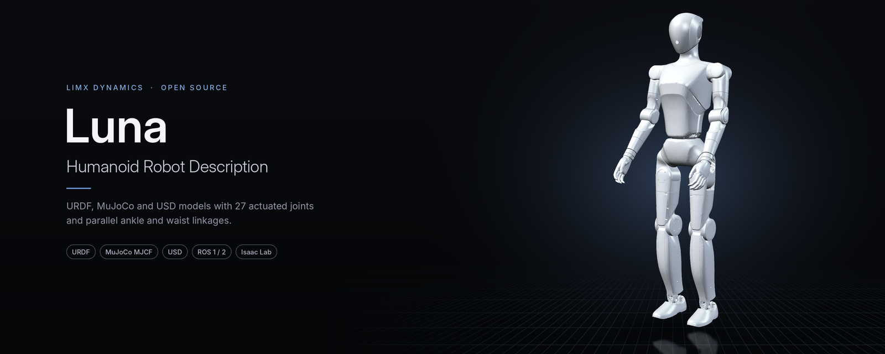

<div align="center">



[English](README.md) | **中文**

[](LICENSE)
[](#ros-1--2)
[](#mujoco)
[](#isaac-sim--isaac-lab)

</div>

LimX Dynamics Luna 人形机器人（HU_L04）的 URDF、MuJoCo MJCF 和 USD 模型文件。提供仿真就绪的机器人描述，支持 ROS、MuJoCo 和 NVIDIA Isaac Sim / Isaac Lab。

## 亮点

- **全身人形，27 个主动关节。** 包含双腿、3 自由度腰部、2 自由度头部和双臂，SRDF 中提供转子惯量、减速比等关节参数。
- **并联连杆如实建模。** 脚踝和腰部由并联连杆驱动；MJCF 用 `equality` 约束表达，`usd_parallel/` 建成真实闭环。
- **一台机器人，覆盖主流仿真器。** ROS 用 URDF、MuJoCo 用 MJCF、Isaac Sim / Isaac Lab 用 USD，几何来源一致。
- **直接接入学习训练流程。** MJCF 自带执行器、关节位置/速度传感器和 IMU，另附用于动作重定向的纯运动学版本。

## 30 秒上手

无需安装 ROS：

```bash
git clone https://github.com/limxdynamics/luna-description.git
cd luna-description
pip install mujoco
python -m mujoco.viewer --mjcf=HU_L04_description/xml/HU_L04_01.xml
```

## 可用型号

| 型号 | 描述 | URDF | MuJoCo MJCF | USD |
| ---- | ---- | ---- | ----------- | --- |
| **HU_L04** | Luna 人形，27 个主动关节 | `urdf/HU_L04_01.urdf` | `xml/HU_L04_01.xml` | `usd/HU_L04_01.usd` |
| **HU_L04（并联）** | 同一机器人，脚踝和腰部的并联连杆按真实闭环建模 | — | — | `usd_parallel/HU_L04_01.usd` |

> **注意：** Luna 的脚踝和腰部通过并联连杆驱动。URDF 无法表达闭环运动链，因此 URDF 及与之对应的 `usd/` 采用串联近似，把脚踝和腰部关节视为直接驱动。MJCF 用 `equality` 约束表达并联连杆；`usd_parallel/` 则把连杆建成真实闭环，供 Isaac Lab 使用。

### 关节布局

| 部位 | 自由度 | 关节 |
| ---- | :----: | ---- |
| 腿部 | 6 × 2 | `hip_pitch`、`hip_roll`、`hip_yaw`、`knee`、`ankle_pitch`、`ankle_roll` |
| 腰部 | 3 | `waist_yaw`、`waist_roll`、`waist_pitch` |
| 头部 | 2 | `head_yaw`、`head_pitch` |
| 手臂 | 5 × 2 | `shoulder_pitch`、`shoulder_roll`、`shoulder_yaw`、`elbow`、`wrist_yaw` |
| **合计** | **27** | 腿部和手臂关节带 `left_` / `right_` 前缀，例如 `left_knee_joint`。 |

### MJCF 内容

| 文件 | 执行器 | 传感器 | 并联连杆 |
| ---- | :----: | ------ | -------- |
| `HU_L04_01.xml` | 27 | 全部 27 个关节的位置和速度，机身 IMU（姿态、陀螺仪、加速度计） | 6 个 `equality` 约束（左脚踝、右脚踝、腰部） |
| `HU_L04_01_vis.xml` | — | — | —（纯运动学，用于动作重定向） |

## 目录结构

`HU_L04_description/` 包含：

| 目录 | 内容 |
|------|------|
| `urdf/` | URDF + SRDF（关节参数：转子惯量、减速比） |
| `xml/` | MuJoCo MJCF XML：`HU_L04_01.xml` 为完整动力学模型（含并联连杆约束、执行器、传感器），`HU_L04_01_vis.xml` 为纯运动学模型（用于动作重定向） |
| `usd/` | NVIDIA USD 文件，与 URDF 一致的串联近似，+ `configuration/` 子目录 |
| `usd_parallel/` | NVIDIA USD 文件，并联连杆按闭环建模，+ `configuration/` 子目录 |
| `meshes/` | STL 网格文件 |
| `world/` | 仿真世界文件 |
| `CMakeLists.txt` | ROS 包构建文件 |
| `package.xml` | ROS 包清单 |

## 使用方法

### ROS 1 / 2

在 ROS 1（catkin）和 ROS 2（ament）下均编译为名为 **`HU_L04_description`** 的功能包。

```bash
cd <workspace>/src
git clone https://github.com/limxdynamics/luna-description.git
cd ..
catkin_make  # 或 colcon build
```

URDF 以 `package://HU_L04_description/meshes/...` 引用网格。在 ROS 之外使用时，请将加载器的 package 路径指向仓库根目录，或直接使用 MJCF / USD 文件。

### MuJoCo

```bash
python -m mujoco.viewer --mjcf=HU_L04_description/xml/HU_L04_01.xml
```

`HU_L04_01_vis.xml` 是纯运动学版本（不含并联连杆、执行器和传感器），供动作重定向使用。

### Isaac Sim / Isaac Lab

通过 Isaac Sim 的参考装配功能导入 `HU_L04_description/usd/HU_L04_01.usd`。若需要闭环并联连杆，改用 `HU_L04_description/usd_parallel/HU_L04_01.usd`。

## 相关仓库

| 仓库 | 描述 |
| ---- | ---- |
| [luna-beyondmimic](https://github.com/limxdynamics/luna-beyondmimic) | Luna 的 BeyondMimic 动作跟踪训练（Isaac Lab） |

## 许可证

Apache License 2.0 — 详见 [LICENSE](LICENSE) 和 [NOTICE](NOTICE)。
